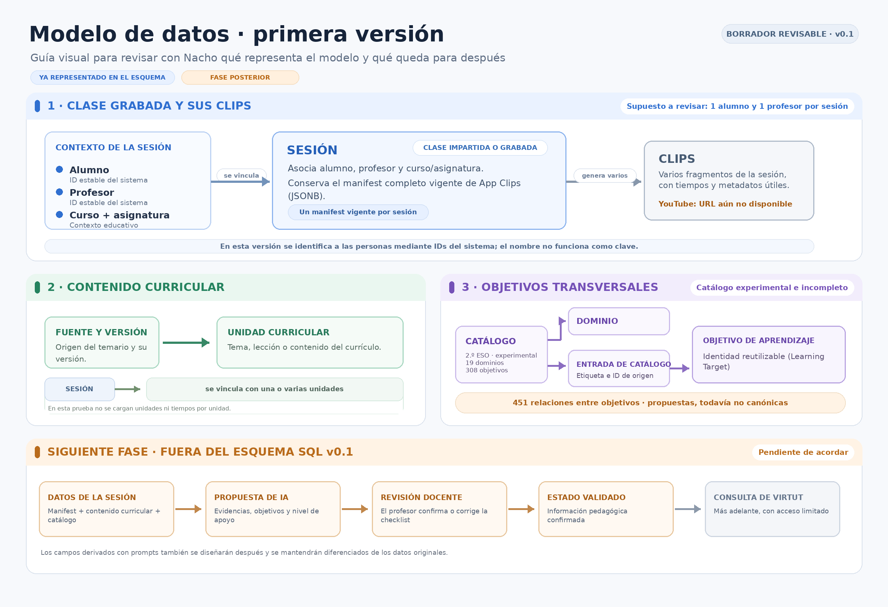

# Informe de primera entrega · modelo de datos v0.1

**Fecha:** 13 de octubre de 2026  
**Estado:** propuesta técnica revisable; no es una base de producción ni cierra las decisiones pedagógicas pendientes.

## 1. Resumen

Se ha preparado un esqueleto visual del modelo y una primera implementación PostgreSQL para representar personas, contexto educativo, sesiones, manifests JSONB, clips, unidades curriculares y un catálogo versionado de objetivos. El paquete PostgreSQL está dirigido a Luis para importación y revisión. Este informe comparte el estado del trabajo y concreta qué revisar con Nacho, con Luis y entre ambos.

La propuesta parte del brief, del inventario de fuentes, de la revisión técnica de SQLite y de los JSON curriculares disponibles. La sesión se modela como una clase concreta, separada de la unidad curricular. La cardinalidad de un alumno y un profesor por sesión es una hipótesis inicial.

## 2. Trabajo realizado

- Modelo visual y explicación de entidades en el [esqueleto ER v0.1](../../arquitectura/modelo-de-datos/esqueleto-er-v0.1.md).
- Migración PostgreSQL con identidades, curso/asignatura, sesión y manifest vigente en JSONB, clips, estructura curricular y catálogo versionado.
- Semilla de prueba con 19 dominios, 308 objetivos y 451 relaciones candidatas del catálogo experimental de Matemáticas de 2.º ESO. Incluye un alumno, un profesor, una sesión y un clip ficticios.
- Paquete técnico autocontenido para Luis, con instrucciones de importación y huellas SHA-256.

Las relaciones de la semilla mantienen el estado `PROPOSED` y `es_canonica = false`. El catálogo se declara experimental e incompleto. La semilla demuestra la estructura y no constituye una validación de cobertura curricular.

## 3. Alcance y límites de v0.1

- La sesión y la unidad curricular son conceptos distintos. No se decide que `Lesson` de App Clips equivalga a una sesión.
- Cada sesión tiene un alumno, un profesor y un contexto de curso/asignatura según la hipótesis inicial del esquema. La cardinalidad se puede revisar si el uso real lo requiere.
- La sesión conserva un único manifest completo vigente en JSONB. Si se actualiza, se reemplaza y se reindexa con el mismo ID; esta entrega no conserva snapshots anteriores.
- Los clips tienen metadatos útiles para consulta. El pipeline actual no genera la URL de YouTube, por lo que esta entrega no incorpora un enlace de ejemplo ni lo trata como dato ya disponible. Se retomará cuando exista el flujo de creación o vinculación de esas URL.
- Las identidades de objetivos se separan de las entradas y etiquetas de cada versión del catálogo. El gobierno de esas identidades entre futuros catálogos queda pendiente.
- El esquema reserva estructura para unidades curriculares, pero la semilla no las carga: los JSON curriculares disponibles describen objetivos y dominios, no un temario estructurado.
- Las checklists, las propuestas de IA, los estados pedagógicos validados y los campos derivados mediante prompts quedan para una fase posterior. Primero habrá que acordar el flujo y el formato de revisión.

## 4. Comprobación técnica

Se importaron el DDL y la semilla en una instancia temporal de PostgreSQL 16 (`postgres:16-alpine`) sin red y con almacenamiento temporal. La semilla se ejecutó dos veces para comprobar que los datos de muestra pueden volver a cargarse.

| Comprobación | Resultado |
|---|---:|
| Versiones de catálogo | 1 |
| Dominios | 19 |
| Objetivos | 308 |
| Relaciones candidatas no canónicas | 451 de 451 |
| Sesiones y clips de prueba | 1 y 1 |
| Consulta conjunta de sesión, alumno, profesor, curso, asignatura, clip y JSONB | Correcta |
| Intervalo de clip inválido | Rechazado por la restricción SQL |

La comprobación demuestra que el esquema se puede importar y que operan las relaciones y restricciones declaradas. No valida el significado pedagógico del catálogo ni sustituye la revisión de Luis.

## 5. Revisión de Nacho: flujo y alcance pedagógico

El diagrama visual acompaña esta revisión. Se pide confirmar:

1. **`Lesson` en App Clips:** qué representa en el flujo actual y cómo debe vincularse con la sesión grabada y el contenido curricular.
2. **Alumnos por sesión:** si el supuesto inicial de un alumno por sesión refleja el uso previsto o hay un caso real de clases con varios alumnos.
3. **Flujo de identidades:** cómo se eligen o asignan los IDs estables de alumno y profesor durante el uso de App Clips. La forma concreta de almacenarlos se revisará también con Luis.
4. **Representación del flujo futuro:** si el modelo distingue correctamente el contenido trabajado y los objetivos transversales para que, más adelante, una checklist permita revisar las propuestas de IA. No se pide definir ahora sus preguntas ni campos.

El catálogo incluido es una carga experimental para comprobar la estructura. Sus 451 relaciones siguen siendo candidatas; la semilla no pide aprobarlas ni cerrar el catálogo.

## 6. Revisión de Luis: importación y diseño técnico

Luis recibe el [paquete PostgreSQL importable](../../../base-de-datos/postgresql/entregas-a-luis/primera-entrega-v0.1/README.md) junto con este informe. Se pide:

1. Importar `esquema.sql` y `datos-iniciales.sql` en una base vacía siguiendo el README, e indicar cualquier error o ajuste necesario.
2. Revisar claves, cardinalidades, restricciones, índices y estrategia de migraciones para esta primera versión.
3. Confirmar que la estructura representa de forma suficiente el manifest JSONB, las identidades y los metadatos de clip para una integración posterior con App Clips.
4. Señalar cambios técnicos que deban hacerse antes de que Nacho conecte el pipeline.

La prueba local del informe no equivale a una importación en el entorno de Luis.

## 7. Puntos compartidos

Hay dos contratos que requieren conocer tanto el flujo fuente como el esquema de destino:

- **IDs de alumno y profesor:** Nacho describe de dónde salen y cuándo se seleccionan o asignan; Luis confirma cómo recibirlos y relacionarlos en PostgreSQL.
- **Mapeo de `Lesson`:** Nacho precisa el significado en App Clips; Luis comprueba la correspondencia con sesión y unidad curricular en el modelo.

Se puede mantener la hipótesis de cardinalidad actual durante la revisión técnica y cambiarla si Nacho confirma otro uso. Las decisiones acordadas se registrarán antes de actualizar el esquema.

## 8. Calidad y privacidad de las fuentes

La revisión de la SQLite encontró `integrity_check = ok`, ninguna infracción de las claves foráneas declaradas y valores JSON válidos en los campos examinados. También registró 16 de 144 lecciones sin transcripción, 25 de 144 sin profesor asociado y 532 de 533 clips con `qualityScore` igual a cero. Estas cifras requieren contexto del proceso; `qualityScore` no tiene semántica documentada y no se usa como regla pedagógica. El análisis técnico interno conserva el detalle y sus límites.

No se incluye la SQLite ni se copian transcripciones, medios, nombres reales o registros de progreso. La sesión y el clip de ejemplo son ficticios; el catálogo procede de los artefactos versionados del repositorio.

## 9. Material de la entrega

- [Esqueleto ER visual y descripción](../../arquitectura/modelo-de-datos/esqueleto-er-v0.1.md)
- [Paquete técnico para Luis](../../../base-de-datos/postgresql/entregas-a-luis/primera-entrega-v0.1/README.md)

El inventario de fuentes y los análisis detallados son documentación interna de trabajo; este informe resume solo los hallazgos necesarios para revisar la entrega.
